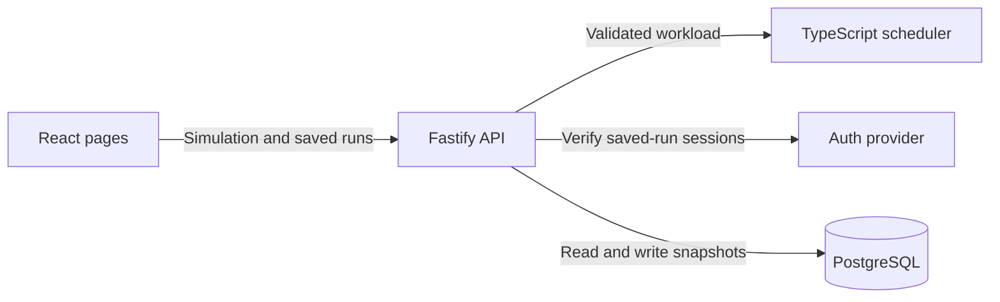

# kairo architecture

The repository currently has a Vite and React starter. The [project spec](project-spec.md) and [GitHub issues](https://github.com/aeqqj/kairo/issues) describe the implementation below.



## Responsibilities

| Part | Owns | Start with |
| --- | --- | --- |
| React pages | Editable inputs, navigation, playback controls, and rendering. Use the shared manual theme and header. | Render the [FCFS and SRTF fixtures](https://github.com/aeqqj/kairo/issues/49) with stub callbacks. |
| Fastify API | Validate the request, call the scheduler, map field errors, and verify the session for saved runs. | Inject a stub scheduler that returns a known run. [Simulation API issue](https://github.com/aeqqj/kairo/issues/62) |
| Scheduler | Assign process IDs P1–P10 in input order, dispatch the selected algorithm, record Idle intervals, and compute metrics. Keep the functions independent of React, Fastify, and storage. | Pass a workload to an algorithm and compare its timeline with the [expected examples](https://github.com/aeqqj/kairo/issues/55). |
| Session and storage | Turn the verified session into an owner ID. Save and retrieve versioned snapshots scoped to that owner. | Use two stub identities and an in-memory store for the first route tests. [Saved-run API issue](https://github.com/aeqqj/kairo/issues/63) |

## Feature-based code layout

Use this layout as features are implemented. Keep the page, its components, and its supporting code in the same feature folder. Add subfolders as the feature grows.

### Browser

```text
src/
├── main.tsx
├── App.tsx
├── index.css
├── features/
│   ├── simulator/
│   │   ├── SimulatorPage.tsx
│   │   ├── components/
│   │   │   ├── WorkloadPanel.tsx
│   │   │   ├── TracePanel.tsx
│   │   │   └── ResultsPanel.tsx
│   │   ├── hooks/
│   │   │   ├── useSimulation.ts
│   │   │   └── usePlayback.ts
│   │   ├── exports.ts
│   │   └── types.ts
│   ├── compare/
│   │   ├── ComparePage.tsx
│   │   └── components/
│   │       └── ComparisonPanel.tsx
│   ├── learn/
│   │   ├── LearnPage.tsx
│   │   ├── AlgorithmArticlePage.tsx
│   │   ├── components/
│   │   │   └── WorkedExample.tsx
│   │   └── worked-examples.ts
│   ├── account/
│   │   ├── SignInPage.tsx
│   │   ├── SignUpPage.tsx
│   │   ├── ForgotPasswordPage.tsx
│   │   ├── ResetPasswordPage.tsx
│   │   ├── components/
│   │   │   └── PasswordField.tsx
│   │   ├── api.ts
│   │   └── types.ts
│   └── history/
│       ├── HistoryPage.tsx
│       └── components/
│           └── SavedRunList.tsx
└── shared/
    ├── components/
    │   ├── Header.tsx
    │   └── TimelineChart.tsx
    └── api/
        ├── simulations.ts
        └── saved-runs.ts
```

`main.tsx` mounts React, `App.tsx` composes the pages, and `index.css` holds global styles. Pages compose components and pass data to them. Hooks hold feature state, such as the current run or playhead. Keep types used by one feature, such as `WorkloadDraft`, in that feature's `types.ts`. Put tests beside the code they exercise.

Simulator, Compare, and Learn can reuse `TimelineChart`. Simulator and Compare use the same simulation client. Simulator and History share the saved-run client. Keep each page's controls and display state with its feature.

### Server

```text
server/src/
├── app.ts
└── features/
    ├── simulations/
    │   ├── routes.ts
    │   ├── schema.ts
    │   └── scheduler/
    │       ├── simulate.ts
    │       ├── metrics.ts
    │       └── algorithms/
    ├── saved-runs/
    │   ├── routes.ts
    │   └── store.ts
    └── auth/
        └── session.ts
```

The simulation routes validate workloads and pass them to the pure scheduler. Saved-run routes use the verified session for ownership checks and the store for persistence.

### Browser and server types

```text
shared/contracts/
├── simulation.ts
└── saved-run.ts
```

Use these files for request and response types both sides import, such as `SimulationRequest`, `SimulationResponse`, and `SavedRunSnapshot`. Keep runtime validation with the server routes.

## Simulation flow

1. The Workload editor holds a draft with the user's entered values. Run checks the draft, records a copy of the submitted workload, and sends `POST /api/simulations` with `algorithm`, `processes`, and `timeQuantum` for Round Robin. Process inputs are numeric `arrivalTime`, `burstTime`, and `priority`.
2. Fastify validates the request before calling the scheduler. Invalid fields return `400` with `errors` entries containing `path` and `message`. For example, `processes[1].burstTime` maps to P2 Burst. The UI keeps the draft available for correction or retry. Reset clears the current run and discards any late response from that request.
3. The scheduler returns `timeline`, `results`, and `averages`. Timeline blocks use `processId`, `start`, and `end`, with `processId: null` for Idle. The chart, results table, average cards, explanation prompt, and exports all use the same response. Show averages to two decimal places.
4. Compare starts from the workload and algorithm that produced the completed run. Each side requests its own result for that workload and both charts use the same time scale. Learn can render its fixed worked examples directly from fixtures. [Compare](https://github.com/aeqqj/kairo/issues/56) · [Learn](https://github.com/aeqqj/kairo/issues/55)

### Trace and playback

Compact and Expanded draw the same timeline. Playback owns the selected time and supplies the playhead and scheduling status. During playback the right column shows On CPU, Ready queue, and Next arrival. At completion, the queue panels disappear, the trace fills its chart area, and Workload is available again. [Playback contract and sample](https://github.com/aeqqj/kairo/issues/57)

Use the scheduler's event ordering for the ready queue. In Round Robin, an arrival exactly at a quantum boundary joins before the expired process goes back into the queue. The playback fixture gives the UI shape for a single time. Coordinate any event data added to the simulation response with the scheduler and API work.

## Accounts and saved runs

Guests can simulate. Sign-in resumes the action that opened it, such as saving the completed run or opening History. Use the completed run's original request for Save run, even if the user has since edited the draft. [Authentication and live wiring](https://github.com/aeqqj/kairo/issues/65)

| Route | Purpose |
| --- | --- |
| `POST /api/runs` | Save the submitted workload with server-generated results. Reuse the `Idempotency-Key` for retries of the same save. |
| `GET /api/runs` | List the signed-in user's runs, newest first. |
| `GET /api/runs/:runId` | Open an owned snapshot. |
| `DELETE /api/runs/:runId` | Delete an owned run after confirmation in the UI. |

The server gets the owner ID from the verified session. Store that ID with `runId`, `createdAt`, `snapshotVersion`, and the original `request` and `response`. PostgreSQL stores the request and response as `jsonb`. When a user opens a saved run from History, render the results from the stored response. [Saved-run routes and status codes](https://github.com/aeqqj/kairo/issues/63)

## Development and deployment

Run `npm run dev` for Vite. Once Fastify is wired up, proxy `/api` requests to it in development. Serve the built frontend and API under the same origin in production. The team will choose an auth provider and PostgreSQL hosting. [Release and deployment issue](https://github.com/aeqqj/kairo/issues/64)

Review UI work with fixtures, algorithm work with deterministic inputs, and API work with stub dependencies. For the live check, run FCFS from the browser and verify that the chart and results match the API response. When accounts are wired, save and reopen a run, then verify that a second identity cannot access it. Run `npm run build` after code changes. [Branch, commit, and PR workflow](workflow.md)
